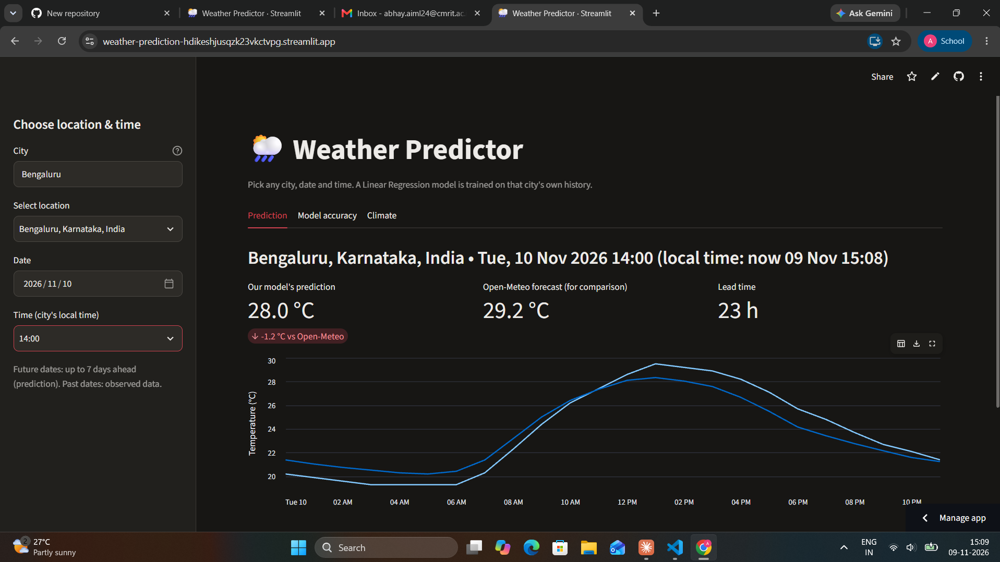
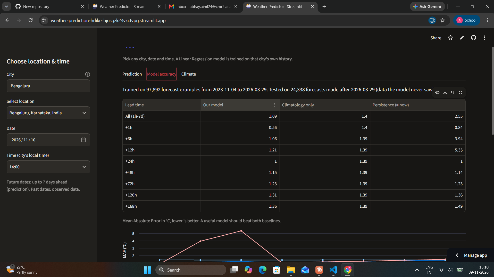

# 🌦️ Weather Predictor: any city, any date & time

Choose **any city in the world**, a **date** and an **hour**, and get the predicted temperature. For each city, a Linear Regression model is trained on that city's own 3-year hourly history, then compared with Open-Meteo's official forecast.

**🔗 Live app:** https://weather-prediction-hdikeshjusqzk23vkctvpg.streamlit.app/




## Features
- 🔎 Search any city (Open-Meteo geocoding API)
- 📅 Pick any future date/hour up to **7 days ahead**, or a past date to see observed temperature
- 🧹 Pandas preprocessing: gap filling, continuous hourly index, anomaly and seasonality features
- 🎯 **Feature selection** (SelectKBest F-test, K chosen by validation error); scores shown in the app
- 🤖 Linear Regression model trained **per city, on demand** and cached
- ⚖️ Side-by-side comparison with Open-Meteo's forecast
- 📊 Honest accuracy report: error by lead time vs. two baselines
- 🌍 Climate tab: average temperature and rainfall by month

## How the model works
1. **Climatology**: average temperature for each (month, hour of day) in that city.
2. **Anomaly**: how much warmer/colder than normal it is *right now*.
3. Anomalies fade with time, so Linear Regression predicts the **future anomaly** from the current anomaly (scaled by `exp(-h/24)` and `exp(-h/72)`), 6 h trend, humidity, wind, 24 h rainfall, pressure change, hour of day and season.
4. **Feature selection** keeps only the most informative features (`SelectKBest`, K picked on a validation slice).
5. **Prediction = climatology(target time) + predicted anomaly.** One model covers all lead times from 1 h to 168 h.

**Evaluation:** time-based split (no shuffling): the model is tested on forecasts made *after* its training period, and compared with climatology-only and persistence ("same as now") baselines.

## Results (Bengaluru)
Mean absolute error in °C on unseen data (forecasts made 28 Mar to 2 Nov 2026):

| Lead time | Our model | Climatology only | Persistence |
|---|---|---|---|
| All (1h-7d) | **1.09** | 1.40 | 2.56 |
| +1h | **0.56** | 1.40 | 0.84 |
| +6h | **1.06** | 1.39 | 3.95 |
| +12h | **1.21** | 1.39 | 5.36 |
| +24h | 1.00 | 1.39 | 0.99 |
| +48h | 1.15 | 1.39 | 1.14 |
| +72h | 1.23 | 1.39 | 1.23 |
| +120h | **1.31** | 1.39 | 1.36 |
| +168h | **1.36** | 1.39 | 1.48 |

**Takeaways:** the model clearly beats the climatology baseline at every lead time and beats persistence at 1 to 12 hours. From 24 to 72 hours it only matches persistence (same time yesterday is a strong baseline). Beyond ~3 days it has little skill over plain climatology.

## Run locally
```bash
python -m venv venv
venv\Scripts\activate            # Windows  (Linux/macOS: source venv/bin/activate)
pip install -r requirements.txt
python train.py "Bengaluru"      # optional: prints accuracy table
streamlit run app.py
```

## Project structure
| File | Purpose |
|---|---|
| `weather_utils.py` | Open-Meteo API calls (geocoding, history, live) with retries |
| `model.py` | Features, climatology, feature selection, training, evaluation, prediction |
| `app.py` | Streamlit interface |
| `train.py` | Command-line training/evaluation report |

## Tech stack
Python · Pandas · NumPy · Scikit-Learn · Streamlit · Altair · Open-Meteo API

## Limitations
- Official forecasts use physics-based models and are generally more accurate; this project demonstrates an end-to-end ML pipeline.
- Results above are for one city over about 7 months of test data.
- Predicts temperature only; trained on a single city's history at a time.
- The free API is rate-limited, so many different cities in a short time may hit the limit.

## Ideas for improvement
Gradient Boosting / Random Forest comparison · more variables (cloud cover, dew point) · evaluate across many cities · predict rainfall.